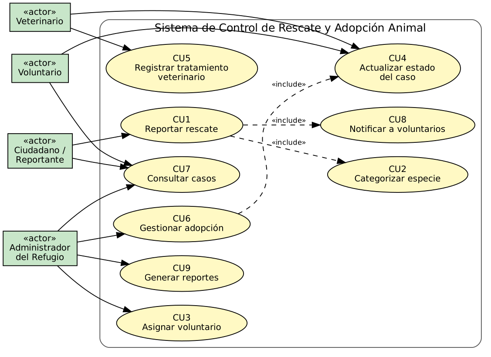
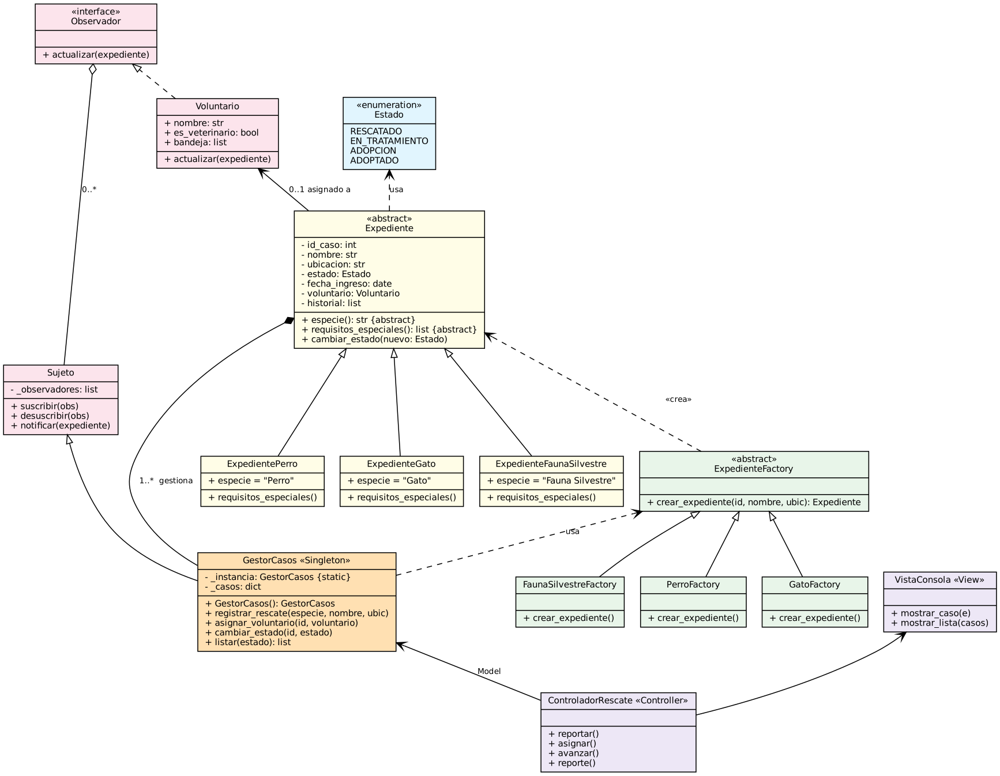
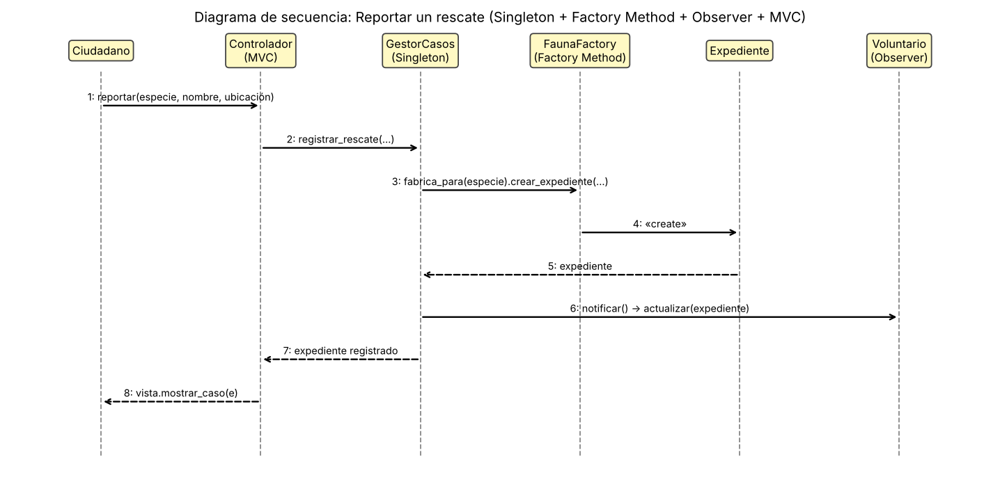
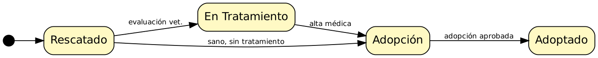

# 2. Modelado UML

## 2.1 Diagrama de casos de uso

Casos de uso: CU1 Reportar rescate, CU2 Categorizar especie, CU3 Asignar voluntario, CU4 Actualizar estado,
CU5 Registrar tratamiento, CU6 Gestionar adopción, CU7 Consultar casos, CU8 Notificar voluntarios, CU9 Generar reportes.
`CU1` incluye `CU2` y `CU8`; `CU6` incluye `CU4`.

## 2.2 Diagrama de clases (principios SOLID)

| Principio | Aplicación |
|---|---|
| **S** – Responsabilidad única | `Expediente` modela datos del caso; `GestorCasos` orquesta; `VistaConsola` solo presenta |
| **O** – Abierto/Cerrado | Nueva especie = nueva subclase + nueva fábrica, sin modificar código existente |
| **L** – Sustitución de Liskov | Cualquier `ExpedientePerro/Gato/FaunaSilvestre` sustituye a `Expediente` |
| **I** – Segregación de interfaces | `Observador` expone solo `actualizar()` |
| **D** – Inversión de dependencias | `GestorCasos` depende de `ExpedienteFactory` y `Observador` (abstracciones) |

## 2.3 Diagrama de secuencia

## 2.4 Diagrama de estados del caso

Los fuentes de los diagramas (`.dot` y `secuencia.py`) se encuentran en `docs/diagramas/`.
